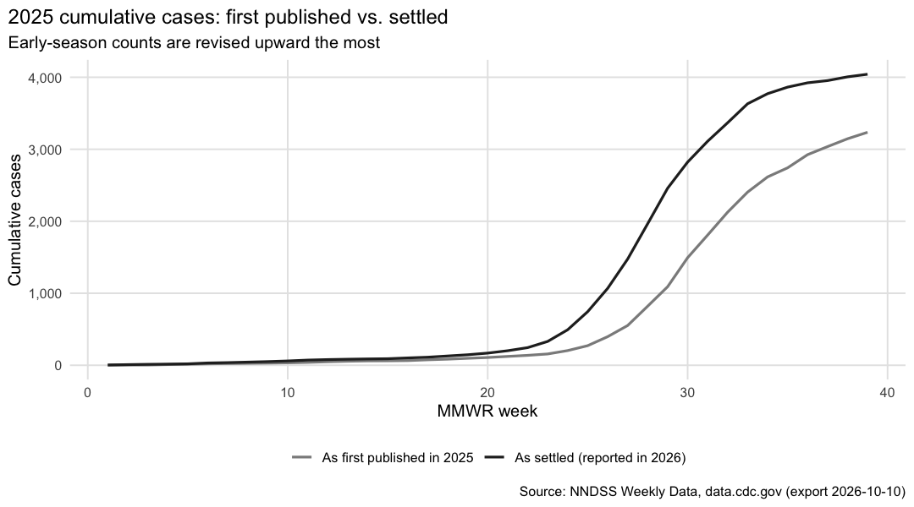
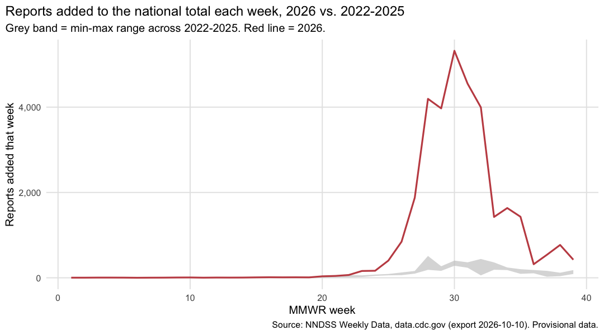
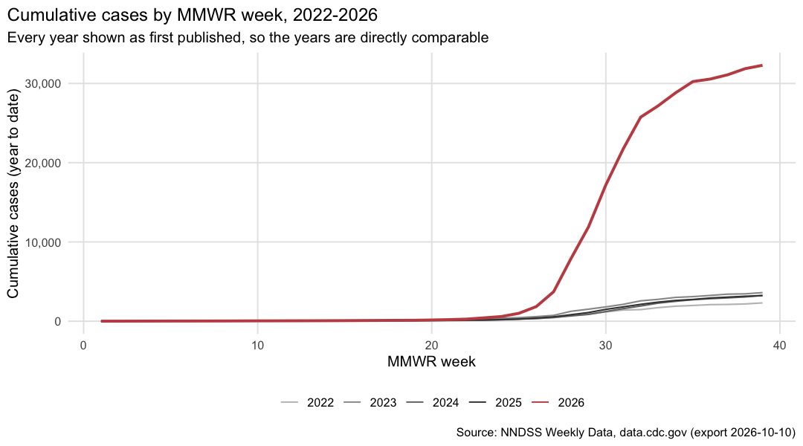
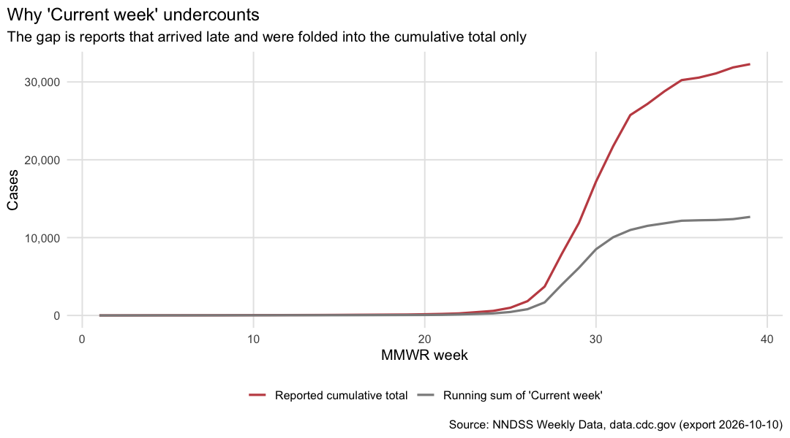
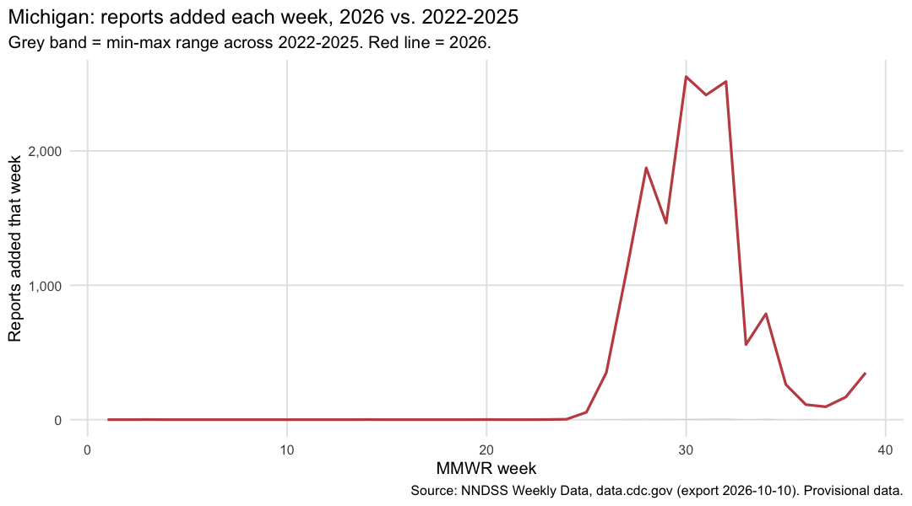
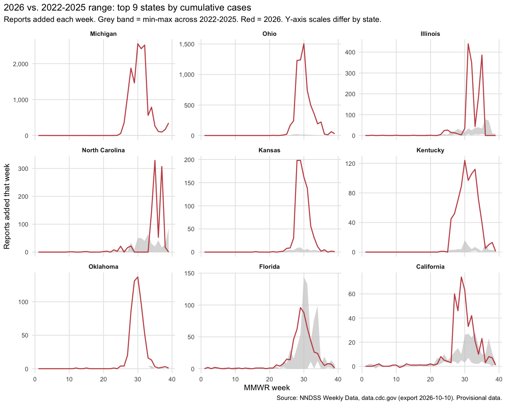

2026 U.S. Cyclosporiasis Outbreak: A Seasonal Baseline Analysis
================
Elizabeth Meehan, MPH

*Version 2, updated October 2026. Data through MMWR week 39 (NNDSS
export of October 10, 2026).*

``` r
# Shared loader: reads both NNDSS exports, cleans them, builds `cyclo` and `latest_week`
source("scripts/00_load_and_clean.R")
```

## What changed since the July version

The first version of this report was built from an NNDSS export
published on July 3, 2026, when only 25 weeks of 2026 data existed and
the national cumulative total stood at 992 cases. This update uses the
October 10 export, which runs through MMWR week 39.

- **The season is far larger than the July snapshot suggested.**
  National cumulative cases reached **32,286** through week 39, which is
  **10.4x** the 2022-2025 average at the same point (3,100), with every
  year compared as first published.
- **The July conclusion held up, and then some.** The July report found
  Michigan far above its own history and suggested a broader pattern.
  Michigan now accounts for **45%** of national cumulative cases and
  Ohio for **20%**.
- **Provisional counts get revised a lot.** The July report said week 25
  was likely an undercount. The data now show how much: 2025’s week 25
  cumulative total was first published as 272 and is now reported as
  744.

## Background

Cyclosporiasis is an intestinal illness caused by the microscopic
parasite *Cyclospora cayetanensis*. A few facts shape how this analysis
is framed:

- **Transmission is foodborne or waterborne only.** People are infected
  by eating food or drinking water contaminated with feces that contain
  the parasite. Freshly shed oocysts are not immediately infectious (it
  takes 1-2 weeks in the environment), so direct person-to-person spread
  does not occur. Case curves therefore tend to reflect exposure to
  shared contaminated food, clustered in time, rather than an
  exponential transmission chain.
- **Incubation** is 2-14 days (average about 1 week) from exposure to
  symptoms.
- **Seasonality:** U.S. cases cluster May to August every year. That
  alone is not evidence of an unusual outbreak, which is why this report
  builds a seasonal baseline from prior years.

## Data

Data come from the **National Notifiable Diseases Surveillance System
(NNDSS)** weekly tables on
[data.cdc.gov](https://data.cdc.gov/NNDSS/NNDSS-Weekly-Data/x9gk-5huc).
Two exports are used:

| File                                       | Used for                 |
|--------------------------------------------|--------------------------|
| `NNDSS_Weekly_Data_2022-2026_20260703.csv` | Baseline years 2022-2025 |
| `NNDSS_Weekly_Data_2026_20261010.csv`      | 2026, weeks 1-39         |

The October export contains only 2026. That is fine because NNDSS rows
are snapshots of what was published in each week and are not rewritten
later. The check below confirms it by comparing the 2026 rows (weeks
1-25) in the two exports.

``` r
july_2026 <- read_nndss(baseline_file) %>%
  filter(year == current_year, label == "Cyclosporiasis", week <= 52)

check <- july_2026 %>%
  inner_join(current %>% filter(label == "Cyclosporiasis"),
             by = c("area", "week"), suffix = c("_jul", "_oct")) %>%
  summarise(
    rows_compared = n(),
    rows_changed  = sum(coalesce(current_week_jul, -1) != coalesce(current_week_oct, -1) |
                        coalesce(cum_ytd_jul, -1)      != coalesce(cum_ytd_oct, -1))
  )
check
```

    ## # A tibble: 1 × 2
    ##   rows_compared rows_changed
    ##           <int>        <int>
    ## 1          1750            0

### Data-cleaning issues

These affect every number in the report, and are worth knowing for any
multi-year government export.

1.  **Inconsistent capitalization across years.** 2022-2024 use ALL CAPS
    (`"MICHIGAN"`), 2025-2026 use Title Case (`"Michigan"`). An
    exact-match filter would silently drop years. Fixed with
    `str_to_title()`.
2.  **Thousands separators stored as text.** Counts over 999 appear as
    `"1,171"`, and `as.numeric("1,171")` silently returns `NA`. Fixed by
    stripping commas.
3.  **The `-` flag does not reliably mean zero.** It appears on blank
    cells (where it does mean zero) and on populated cells (where it is
    only an annotation). The rule used here: trust a populated value,
    and read the flag only for blank cells.
4.  **Aggregate labels do not unify with case normalization.**
    `"US RESIDENTS"` becomes `"Us Residents"`, not `"U.S. Residents"`.
    This report uses only the `"Total"` row and the 50 states plus DC,
    which do unify.

The cleaning function (from `scripts/00_load_and_clean.R`):

``` r
clean_flagged_col <- function(value_col, flag_col) {
  numeric_val <- suppressWarnings(as.numeric(str_remove_all(as.character(value_col), ",")))
  case_when(
    !is.na(numeric_val)             ~ numeric_val,   # a real value was reported: always trust it
    flag_col == "-"                 ~ 0,              # blank + "-" flag = zero
    flag_col %in% c("N", "NC", "U") ~ NA_real_,       # not reportable / not calculated / unavailable
    TRUE ~ NA_real_
  )
}
```

## How NNDSS counts get revised

Because each weekly row is frozen at publication, early-season counts
look much smaller than they eventually become. The only place revisions
are visible is the “previous year” cumulative column in the next year’s
rows. Comparing 2025 as first published (2025 rows) with 2025 as settled
(2026 rows) shows the size of the effect.

``` r
vintage <- national %>%
  filter(year == 2025, week <= latest_week) %>%
  select(week, first_published = cum_ytd) %>%
  inner_join(season_2026 %>% select(week, settled = cum_prior_year_settled), by = "week") %>%
  mutate(ratio = settled / first_published)

vintage %>%
  filter(week %in% c(25, 30, 35, latest_week)) %>%
  knitr::kable(digits = 2,
               col.names = c("MMWR week", "First published", "Settled", "Settled / first published"),
               format.args = list(big.mark = ","))
```

| MMWR week | First published | Settled | Settled / first published |
|----------:|----------------:|--------:|--------------------------:|
|        25 |             272 |     744 |                      2.74 |
|        30 |           1,494 |   2,822 |                      1.89 |
|        35 |           2,742 |   3,863 |                      1.41 |
|        39 |           3,236 |   4,042 |                      1.25 |

``` r
vintage_long <- vintage %>%
  pivot_longer(c(first_published, settled), names_to = "version", values_to = "cum") %>%
  mutate(version = recode(version,
                          first_published = "As first published in 2025",
                          settled = "As settled (reported in 2026)"))

ggplot(vintage_long, aes(week, cum, color = version)) +
  geom_line(linewidth = 0.9) +
  scale_color_manual(values = c("As first published in 2025" = "grey55",
                                "As settled (reported in 2026)" = "grey15")) +
  scale_y_continuous(labels = scales::comma) +
  labs(title = "2025 cumulative cases: first published vs. settled",
       subtitle = "Early-season counts are revised upward the most",
       x = "MMWR week", y = "Cumulative cases", color = NULL,
       caption = paste0("Source: NNDSS Weekly Data, data.cdc.gov (export ", export_date, ")")) +
  theme_epi() + theme(legend.position = "bottom")
```

<!-- -->

Two consequences follow. First, all baseline comparisons in this report
use every year **as first published**, so the comparison is like for
like. Second, the 2026 numbers are provisional in the same way, and will
be revised upward as well. The 10.4x figure is a same-vintage
comparison; against 2025 as settled (4,042), 2026 is 8.0x, but that
mixes a provisional count with a settled one.

## The 2026 season nationally

The weekly measure used here is **reports added to the cumulative total
each week** (the week-over-week change in the cumulative column). It is
a reporting curve, not an epidemic curve by onset date, so it includes
late reports for earlier weeks. The reason it is used instead of the
`Current week` column is shown in the next section.

``` r
band <- national %>%
  filter(year %in% baseline_years, week <= latest_week) %>%
  group_by(week) %>%
  summarise(lo = min_na(weekly_additions), hi = max_na(weekly_additions), .groups = "drop") %>%
  left_join(season_2026 %>% select(week, weekly_additions), by = "week")

ggplot(band, aes(x = week)) +
  geom_ribbon(aes(ymin = lo, ymax = hi), fill = "grey80", alpha = 0.7) +
  geom_line(aes(y = weekly_additions), color = accent_color, linewidth = 0.9) +
  scale_y_continuous(labels = scales::comma) +
  labs(title = "Reports added to the national total each week, 2026 vs. 2022-2025",
       subtitle = "Grey band = min-max range across 2022-2025. Red line = 2026.",
       x = "MMWR week", y = "Reports added that week",
       caption = paste0("Source: NNDSS Weekly Data, data.cdc.gov (export ", export_date, "). Provisional data.")) +
  theme_epi()
```

<!-- -->

Reports added peaked in MMWR week **30** at **5,320** in a single week,
then fell sharply by week 36. The same story in cumulative form:

``` r
year_colors <- c("2022" = "grey75", "2023" = "grey60", "2024" = "grey45",
                 "2025" = "grey25", "2026" = accent_color)

national %>%
  filter(week <= latest_week) %>%
  mutate(year_lab = factor(year)) %>%
  ggplot(aes(week, cum_ytd, color = year_lab, linewidth = year_lab)) +
  geom_line() +
  scale_color_manual(values = year_colors) +
  scale_linewidth_manual(values = c("2022" = 0.6, "2023" = 0.6, "2024" = 0.6, "2025" = 0.6, "2026" = 1.1)) +
  scale_y_continuous(labels = scales::comma) +
  labs(title = "Cumulative cases by MMWR week, 2022-2026",
       subtitle = "Every year shown as first published, so the years are directly comparable",
       x = "MMWR week", y = "Cumulative cases (year to date)", color = NULL,
       caption = paste0("Source: NNDSS Weekly Data, data.cdc.gov (export ", export_date, ")")) +
  guides(linewidth = "none") +
  theme_epi() + theme(legend.position = "bottom")
```

<!-- -->

``` r
season_2026 %>%
  filter(week %in% c(25, 28, 30, 33, 36, latest_week)) %>%
  select(week, current_week, weekly_additions, cum_ytd) %>%
  knitr::kable(col.names = c("MMWR week", "'Current week' column", "Reports added", "Cumulative"),
               format.args = list(big.mark = ","))
```

| MMWR week | ‘Current week’ column | Reports added | Cumulative |
|----------:|----------------------:|--------------:|-----------:|
|        25 |                   180 |           403 |        992 |
|        28 |                 2,275 |         4,194 |      7,909 |
|        30 |                 2,393 |         5,320 |     17,199 |
|        33 |                   530 |         1,426 |     27,169 |
|        36 |                    57 |           318 |     30,553 |
|        39 |                   289 |           424 |     32,286 |

## Why “Current week” undercounts

The `Current week` column is frozen at the moment of publication, while
the cumulative total absorbs reports that arrive late. Through week 39,
the `Current week` values sum to **12,663**, only **39%** of the
**32,286** cumulative total. The gap grew every week, which is why the
report uses cumulative differences for weekly trends.

``` r
lag_long <- season_2026 %>%
  arrange(week) %>%
  mutate(running_sum_current_week = cumsum(replace_na(current_week, 0))) %>%
  select(week, running_sum_current_week, cum_ytd) %>%
  pivot_longer(-week, names_to = "series", values_to = "cases") %>%
  mutate(series = recode(series,
                         running_sum_current_week = "Running sum of 'Current week'",
                         cum_ytd = "Reported cumulative total"))

ggplot(lag_long, aes(week, cases, color = series)) +
  geom_line(linewidth = 0.9) +
  scale_color_manual(values = c("Running sum of 'Current week'" = "grey55",
                                "Reported cumulative total" = accent_color)) +
  scale_y_continuous(labels = scales::comma) +
  labs(title = "Why 'Current week' undercounts",
       subtitle = "The gap is reports that arrived late and were folded into the cumulative total only",
       x = "MMWR week", y = "Cases", color = NULL,
       caption = paste0("Source: NNDSS Weekly Data, data.cdc.gov (export ", export_date, ")")) +
  theme_epi() + theme(legend.position = "bottom")
```

<!-- -->

## Michigan

In the July report, Michigan’s week-25 count was 0, 0, 1 and 0 in
2022-2025 against 46 in 2026. Three months later:

``` r
michigan %>%
  filter(week == latest_week) %>%
  select(year, cum_ytd) %>%
  arrange(year) %>%
  mutate(year = as.character(year)) %>%
  knitr::kable(col.names = c("Year", paste0("Cumulative cases through week ", latest_week, " (as first published)")),
               format.args = list(big.mark = ","))
```

| Year | Cumulative cases through week 39 (as first published) |
|:-----|------------------------------------------------------:|
| 2022 |                                                    26 |
| 2023 |                                                    34 |
| 2024 |                                                    35 |
| 2025 |                                                    36 |
| 2026 |                                                14,660 |

``` r
mi_2026 <- michigan %>% filter(year == current_year) %>% select(week, current_week, weekly_additions, cum_ytd)

mi_band <- michigan %>%
  filter(year %in% baseline_years, week <= latest_week) %>%
  group_by(week) %>%
  summarise(lo = min_na(weekly_additions), hi = max_na(weekly_additions), .groups = "drop") %>%
  left_join(mi_2026 %>% select(week, weekly_additions), by = "week")

ggplot(mi_band, aes(x = week)) +
  geom_ribbon(aes(ymin = lo, ymax = hi), fill = "grey80", alpha = 0.7) +
  geom_line(aes(y = weekly_additions), color = accent_color, linewidth = 0.9) +
  scale_y_continuous(labels = scales::comma) +
  labs(title = "Michigan: reports added each week, 2026 vs. 2022-2025",
       subtitle = "Grey band = min-max range across 2022-2025. Red line = 2026.",
       x = "MMWR week", y = "Reports added that week",
       caption = paste0("Source: NNDSS Weekly Data, data.cdc.gov (export ", export_date, "). Provisional data.")) +
  theme_epi()
```

<!-- -->

Michigan’s cumulative total (14,660) is 45% of the national total, and
its prior-year range at this point in the season was only 26-36 cases.

**One thing to watch:** Michigan’s reports added fell to between 96 and
168 per week in weeks 36-38, then rose again in week 39 (349). The
`Current week` column also jumps (5 to 244). This file cannot say
whether that is a late batch of reports or a new increase, so it needs
rechecking once weeks 40 and later are published.

## State comparison

Each state is compared with itself: its 2026 cumulative count against
its own 2022-2025 mean at the same MMWR week, all as first published.

``` r
state_data <- cyclo %>% filter(area %in% us_states)

now_vals <- state_data %>% filter(year == current_year, week == latest_week) %>%
  select(area, cases_2026 = cum_ytd)
baseline_vals <- state_data %>% filter(year %in% baseline_years, week == latest_week) %>%
  group_by(area) %>% summarise(baseline_avg = mean(cum_ytd, na.rm = TRUE), .groups = "drop")

state_ranking <- now_vals %>%
  full_join(baseline_vals, by = "area") %>%
  mutate(
    cases_2026   = replace_na(cases_2026, 0),
    baseline_avg = replace_na(baseline_avg, 0),
    share_of_national = cases_2026 / cum_now,
    ratio_label = case_when(
      baseline_avg == 0 & cases_2026 == 0 ~ "no change (both 0)",
      baseline_avg == 0 & cases_2026 > 0  ~ "new (baseline was 0)",
      TRUE ~ paste0(round(cases_2026 / baseline_avg, 1), "x")
    )
  ) %>%
  arrange(desc(cases_2026))

state_ranking %>%
  slice_head(n = 10) %>%
  select(area, baseline_avg, cases_2026, share_of_national, ratio_label) %>%
  mutate(share_of_national = scales::percent(share_of_national, accuracy = 0.1)) %>%
  knitr::kable(digits = 1,
               col.names = c("State", "2022-25 mean", paste0("2026 through wk ", latest_week), "Share of national", "vs. baseline"),
               format.args = list(big.mark = ","))
```

| State | 2022-25 mean | 2026 through wk 39 | Share of national | vs. baseline |
|:---|---:|---:|:---|:---|
| Michigan | 32.8 | 14,660 | 45.4% | 447.6x |
| Ohio | 73.2 | 6,527 | 20.2% | 89.1x |
| Illinois | 218.0 | 1,534 | 4.8% | 7x |
| North Carolina | 197.0 | 930 | 2.9% | 4.7x |
| Kansas | 29.5 | 857 | 2.7% | 29.1x |
| Kentucky | 37.0 | 837 | 2.6% | 22.6x |
| Oklahoma | 30.0 | 572 | 1.8% | 19.1x |
| Florida | 300.0 | 543 | 1.7% | 1.8x |
| California | 146.5 | 428 | 1.3% | 2.9x |
| New York | 180.8 | 380 | 1.2% | 2.1x |

``` r
top5_share <- sum(head(state_ranking$cases_2026, 5)) / cum_now
n_states_up <- sum(state_ranking$cases_2026 > state_ranking$baseline_avg & state_ranking$cases_2026 > 0)
n_reporting <- sum(!is.na(now_vals$cases_2026))
```

The top five states account for **76%** of the national cumulative
total, and 38 of the 48 states and DC that report cyclosporiasis to
NNDSS are above their own 2022-2025 level. Michigan and Ohio dominate,
but the rise is not limited to them.

``` r
top_states <- state_ranking %>% slice_max(cases_2026, n = 9) %>% pull(area)
top_weekly <- state_data %>% filter(area %in% top_states, week <= latest_week)

state_band <- top_weekly %>%
  filter(year %in% baseline_years) %>%
  group_by(area, week) %>%
  summarise(lo = min_na(weekly_additions), hi = max_na(weekly_additions), .groups = "drop")

state_band %>%
  left_join(top_weekly %>% filter(year == current_year) %>% select(area, week, weekly_additions),
            by = c("area", "week")) %>%
  mutate(area = factor(area, levels = top_states)) %>%
  ggplot(aes(x = week)) +
  geom_ribbon(aes(ymin = lo, ymax = hi), fill = "grey80", alpha = 0.7) +
  geom_line(aes(y = weekly_additions), color = accent_color, linewidth = 0.7) +
  facet_wrap(~ area, scales = "free_y", ncol = 3) +
  scale_y_continuous(labels = scales::comma) +
  labs(title = "2026 vs. 2022-2025 range: top 9 states by cumulative cases",
       subtitle = "Reports added each week. Grey band = min-max across 2022-2025. Red = 2026. Y-axis scales differ by state.",
       x = "MMWR week", y = "Reports added that week",
       caption = paste0("Source: NNDSS Weekly Data, data.cdc.gov (export ", export_date, "). Provisional data.")) +
  theme_epi(base_size = 11) + theme(strip.text = element_text(face = "bold"))
```

<!-- -->

State-level weekly series are lumpy because states send reports in
batches. Illinois, for example, added 386 reports in week 35 and none in
weeks 36-39, and North Carolina alternates between large weeks and
near-zero weeks. Read single weeks at the state level with caution; the
cumulative totals are more reliable.

## What this analysis can and cannot say

- **It describes reporting, not exposure.** NNDSS weekly tables carry no
  onset dates and no food-source information. Public reporting from late
  July linked a subcluster of the outbreak to shredded iceberg lettuce,
  while a broader investigation into other clusters had not identified a
  product (see Sources). Nothing in this dataset can confirm or refine
  that.
- **All counts are provisional and will rise.** 2025’s week-25 total was
  revised upward by a factor of about 2.7. Expect the same for 2026,
  with early weeks revised the most.
- **NNDSS and CDC outbreak-page counts are different measures** and will
  not match. CDC’s outbreak reporting uses its own case definitions and
  counting windows.
- **Three states have no NNDSS values for cyclosporiasis:** Idaho,
  Mississippi and Pennsylvania carry the “not reportable” flag. Kentucky
  also has no 2022 values, so its baseline uses three years. New York
  City reports separately from New York State and is excluded from the
  state ranking.
- **One baseline anomaly:** Colorado’s 2024 cumulative total jumped by
  144 in week 39 and was reversed in week 49. As first published, it
  inflates the national 2024 baseline at week 39 by 144 cases (a shift
  of about 36 cases in the four-year average), which does not change any
  conclusion here.
- **The last published week is the least reliable.** The week-39 uptick
  nationally and in Michigan should be rechecked once later weeks are
  available.

## Next steps

- Re-pull NNDSS when weeks 40 and later are published, and save it as a
  new dated file.
- Compare this snapshot with the next to see how much 2026 gets revised.
- Map state-level cumulative counts with `tigris` and `sf`.
- If county-level data become public for Michigan or Ohio, add them as a
  separate, clearly labeled dataset.

## Sources

- Centers for Disease Control and Prevention. *NNDSS Weekly Data* \[Data
  set\]. data.cdc.gov.
  <https://data.cdc.gov/NNDSS/NNDSS-Weekly-Data/x9gk-5huc> (exports
  retrieved July 3 and October 10, 2026).
- ABC News. (2026, July 29). *More than 18,000 cyclosporiasis cases
  reported across 45 states: CDC*.
  <https://www.goodmorningamerica.com/wellness/story/18000-cyclosporiasis-cases-reported-45-states-cdc-135194065>
- NC State Extension. (2026, July 21). *Update on cyclosporiasis cases
  and information*.
  <https://ncfreshproducesafety.ces.ncsu.edu/news/update-on-cyclosporiasis-cases-and-information/>

## AI assistance disclosure

Portions of this project’s R code, data-cleaning logic, and
documentation were drafted with assistance from Claude (Anthropic). All
research questions, methodological decisions, and interpretation of
findings are my own.
